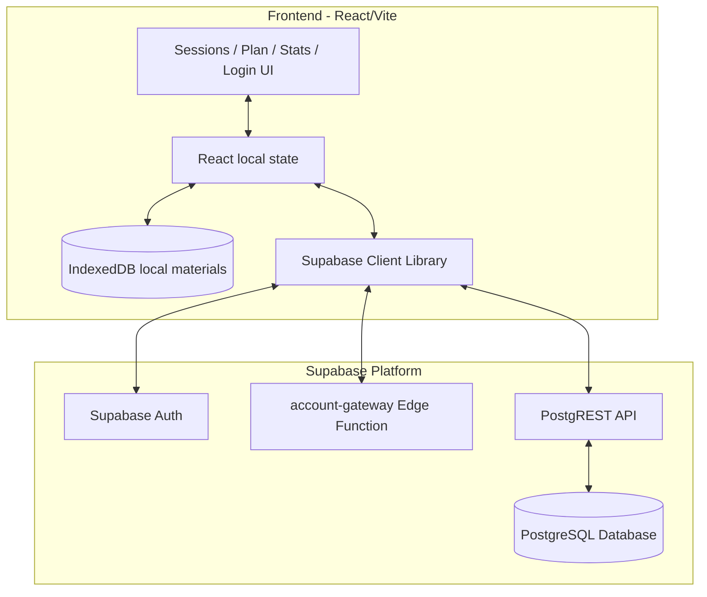

# System Architecture

This document describes the current high-level architecture of Guitar Practice Hub.

## High-Level Diagram

## System Components

### 1. Frontend
The application is a **single-page application (SPA)**.
- **View layer:** React components for Sessions, Plan, and Stats, combined through the shared app shell.
- **Logic layer:** page-local state handles week/day navigation, timers, metronome controls, forms, and stats filters.
- **Data access layer:** `@supabase/supabase-js` communicates directly with Supabase.

### 2. Backend as a Service: Supabase
The project uses **Backend as a Service** instead of a custom Node.js or Python server:
- **Authentication:** manages user sessions and JWT tokens.
- **Database:** PostgreSQL with Row Level Security (RLS).
- **API layer:** PostgREST provides access to database tables.
- **Server-only account boundary:** `account-gateway` creates accounts and resets passwords using service-role access that never reaches the browser.
- **Local materials:** IndexedDB stores uploaded learning files on the current device; files are not sent to Supabase.

## Security

Data security is enforced server-side through **Supabase Row Level Security (RLS)**:
1. The user authenticates through Supabase Auth.
2. The client sends requests with the user's JWT.
3. PostgreSQL evaluates each row policy, typically against `auth.uid()`.
4. Data is returned only when the policy permits access.

## Data Flow

### Saving a practice session
1. The user selects a week and day, completes blocks, and enters time or notes.
2. The frontend upserts the parent row with `supabase.from('sessions').upsert(...)`.
3. The frontend deletes only deselected session blocks.
4. The frontend upserts retained blocks into `session_blocks` using `(session_id, block_key)`.
5. Supabase validates the JWT and RLS policies for each request.
6. The frontend displays the save result and refreshes local state.

## Current Limitations

- `session_blocks` uses unique `(session_id, block_key)` and the Sessions write path performs targeted delete plus upsert.
- Enum-like fields such as `songs.status`, `sessions.source`, and `block_templates.key` are open `text` fields without database `CHECK` constraints. This is an explicit v1 trade-off; the application and seed data currently enforce the expected values by convention.
- Microphone pitch detection is deferred. The tuner reference-tone slice is implemented. The learning-materials viewer uses device-local IndexedDB and is being expanded for inline media compatibility.
