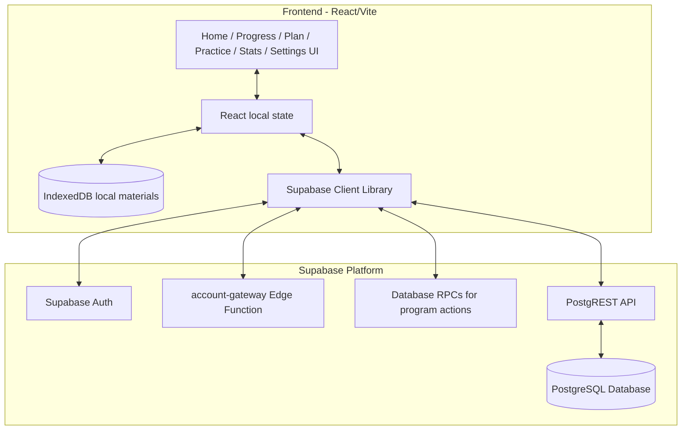

# System Architecture

This document describes the current high-level architecture of Guitar Practice Hub.

## High-Level Diagram

## System Components

### 1. Frontend
The application is a **single-page application (SPA)**.
- **View layer:** React pages for Home, Progress, Plan, Practice, Stats, and Settings, combined through the shared app shell.
- **Navigation shell:** a floating menu provides Home, Progress, Plan, Practice, Stats, and Settings routes; child routes provide browser-history back navigation with a Home fallback.
- **Logic layer:** page-local state handles week/day navigation, timers, metronome controls, forms, and stats filters.
- **Data access layer:** `@supabase/supabase-js` communicates directly with Supabase.

### 2. Backend as a Service: Supabase
The project uses **Backend as a Service** instead of a custom Node.js or Python server:
- **Authentication:** manages user sessions and JWT tokens.
- **Database:** PostgreSQL with Row Level Security (RLS).
- **API layer:** PostgREST provides access to database tables.
- **Server-only account boundary:** `account-gateway` creates accounts and resets passwords using service-role access that never reaches the browser.
- **Language preference:** account creation accepts one of `en`, `ru`, `it`, or `fr`; the preference is persisted in `app_settings` and can later be changed from Settings.
- **Onboarding tour state:** `app_settings.onboarding_tour_pending` (boolean, default `false`) is set to `true` only by `account-gateway` at account creation. The app reads it once on first entry, clears it immediately, and runs the per-screen tour from in-memory state. Existing accounts keep `false`, so they never see the tour. The per-screen Help button replays one screen's tour and never touches this flag.
- **Program content language:** programs store a content-language value in `programs.language`. Continuation uses that stored value rather than the current interface preference; immutability is an application convention, not a database-enforced guarantee.
- **Practice-block catalog and composition:** `block_templates` contains shared and owner-specific catalog entries, category and selectable/archive metadata. `programs.block_set_mode` selects legacy-unconfigured, same-every-week, or varying-week composition; ordered membership lives in `program_blocks` or `plan_week_blocks`. Authenticated RPCs validate composition changes; clients do not write membership tables directly.
- **Program lifecycle actions:** database RPCs manage program start, pause, resume, continuation, and schedule changes. The currently visible Plan UI focuses on week and composition workflows; the presence of a lifecycle RPC does not imply a start/resume button in the UI.
- **Local materials:** IndexedDB stores uploaded learning files on the current device; files are not sent to Supabase.

## Security

Data security is enforced server-side through **Supabase Row Level Security (RLS)**:
1. The user authenticates through Supabase Auth.
2. The client sends requests with the user's JWT.
3. PostgreSQL evaluates each row policy, typically against `auth.uid()`.
4. Data is returned only when the policy permits access.

## Data Flow

### Saving a practice session
1. The user selects a week and day, completes blocks, and enters time or notes.
2. The frontend upserts the parent row with `supabase.from('sessions').upsert(...)`.
3. The frontend deletes only deselected session blocks.
4. The frontend upserts retained blocks into `session_blocks` using `(session_id, block_key)`.
5. Supabase validates the JWT and RLS policies for each request.
6. The frontend displays the save result and refreshes local state.

### Program timeline and week insertion

1. Progress loads scheduled weeks, program names, sessions, and visibility preferences.
2. Adjacent weeks with the same `program_id` form one contiguous program period; returning to a previous program creates a new period in the timeline.
3. Program periods collapse into timeline nodes, with the current period opened initially and every week remaining clickable to Plan.
4. Current and future weeks expose inline insertion forms backed by `insert_plan_week`, which shifts later scheduled weeks without pausing the active program.

### Practice-block catalog and Repertoire

1. Practice reads shared selectable catalog blocks plus the authenticated user's own blocks; category selection filters the gallery, and selecting a block performs the screen's existing add/replace action.
2. Plan composes a program or week from the same catalog. Same-every-week programs use ordered `program_blocks`; varying-week programs use ordered `plan_week_blocks`.
3. Progress selects week blocks when inserting into a varying-week program; same-every-week programs inherit their program set.
4. Repertoire songs remain user-owned rows linked to plan weeks through `week_songs`. The Plan editor replaces a week's links atomically through `replace_week_repertoire_songs`; unlinking does not delete song records. Practice displays those songs with song-scoped local materials.
5. Plan's multi-resource save is not fully atomic: song links save after other Plan fields, so failure of the final song RPC can leave earlier fields saved while song associations remain unchanged.

### Continuing the Default program
1. Auth restoration asks the client to load the active Default program's stored content language and matching focus/task copy, then calls one database RPC. The client does not decide whether continuation is due or calculate dates. The language is treated as stable by the app but is not immutable at the database level.
2. The RPC authenticates with `auth.uid()`, takes the user's transaction-scoped schedule lock, and checks that an owned Default program is active.
3. The database calculates today's date in UTC and the current UTC Monday-Sunday interval. It continues only when the last scheduled Default week ended before UTC today.
4. Before inserting, the RPC checks every scheduled week owned by the user for an inclusive date overlap with that interval. An overlap returns a conflict without inserting, shifting, or otherwise mutating any week. Unscheduled weeks have all three scheduling fields null and do not overlap.
5. On success, the RPC inserts one week in the current UTC interval. A retry in the same week is a no-op because the inserted week is now the latest scheduled Default week. Missed weeks are never backfilled; custom programs are not auto-extended.

Continuation and competing schedule mutations share one per-user transaction lock. RPCs take it before reading or changing schedule state; database triggers take it for direct schedule-field writes and program lifecycle changes, including service-role writes. This serialization makes the overlap check and insertion atomic with manual rescheduling and other schedule changes.

Migration `20261003120000_serialize_default_program_continuation.sql` was applied and catalog-verified on 2026-10-03. Local reset/pgTAP coverage passes; current test and hosted-release identity is tracked in `docs/project-handoff.md`. A service-role bulk transaction touching multiple users in opposite row order can deadlock on per-user trigger locks; any supported bulk caller should have retry handling.

### Language selection and content ownership
1. A new user selects a language only in Create account mode.
2. `account-gateway` validates the language, creates `app_settings`, and creates the first default program with the matching `programs.language` value.
3. A returning user signs in without changing the saved language.
4. Settings can update `app_settings.language` for interface behavior only.
5. Existing programs, weeks, sessions, songs, comments, and notes are never translated as a side effect of changing Settings.

### First-entry guided tour
1. `account-gateway` inserts `app_settings` with `onboarding_tour_pending = true` for a new account.
2. `Layout` (inside the router) reads the flag once; if `true`, it sets `onboarding_tour_pending = false` and keeps an in-memory onboarding state with a set of visited screens.
3. On each route, if onboarding is active and the screen is unvisited, that screen's steps run once; Skip ends onboarding for all screens.
4. The Help button in `Layout` replays the current screen's steps at any time without writing to Supabase.

## Current Limitations

- `session_blocks` uses unique `(session_id, block_key)` and the Sessions write path performs targeted delete plus upsert.
- Flexible Programs intentionally uses nullable week dates for unscheduled branch rows; all read paths must filter them before showing visible plan/calendar state.
- New scheduled weeks are program-owned and carry a required `program_sequence`; the unused `plan_weeks.phase` field is no longer part of the model.
- `songs.status` and `sessions.source` have validated PostgreSQL domain `CHECK` constraints. Item 15 also constrained the original template keys, but the catalog migration removed that key-domain constraint to support new built-in and owner-specific keys. `block_templates` instead constrains categories and custom-block ownership; `session_blocks.block_key` remains free text for imported/historical snapshots.
- Pure logic tests use Vitest in Node; the supported runtime range is `^22.12.0 || ^24.0.0 || >=26.0.0`; the latest recorded frontend validation used Node 24.19.0. Plan-week RPC integration tests run against a disposable local Supabase instance only. The isolated local config and historical migration baseline live under `supabase/local-test/supabase/`; run with `npx supabase --workdir supabase/local-test`. The original item-15 slice passed 35 pgTAP tests; subsequent local coverage totals 111 tests across four files per the current handoff. Never point DB tests at the linked production project or treat the local baseline as remote migration history.
- Microphone pitch detection is deferred. The tuner reference-tone slice and the local learning-materials viewer are live.
- Mobile pinch zoom is intentionally disabled through the viewport configuration.
- The language preference and UI string catalog support English, Russian, Italian, and French. User-owned content remains in its stored language by design.
