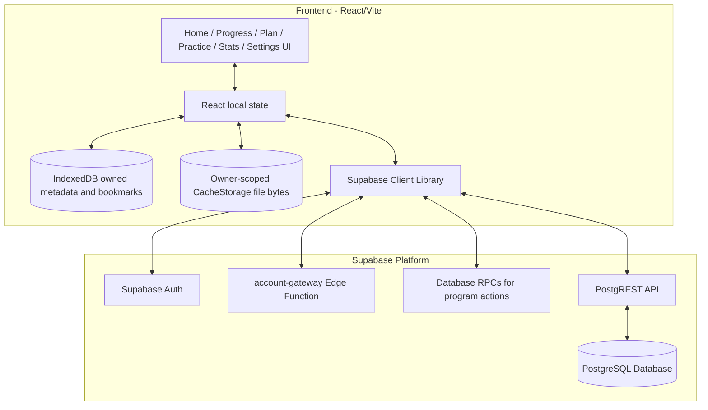

# System Architecture

This document describes the high-level architecture of Pro100Practice. Current implementation, release and acceptance status is maintained in the [backlog](guitar-hub-v1-scope-and-backlog.md) and [handoff](project-handoff.md); dated evidence below is historical verification, not a new live check.

## High-Level Diagram

File bytes use CacheStorage only when CacheStorage and Web Locks are available; otherwise they remain in IndexedDB alongside the owned metadata. Both paths stay local to the browser/device and origin. Hidden ownerless legacy storage is preserved separately.

## System Components

### 1. Frontend
The application is a **single-page application (SPA)**.
- **View layer:** React pages for Home, Progress, Plan, Practice, Stats, and Settings, combined through the shared app shell.
- **Navigation shell:** a floating menu provides Home, Progress, Plan, Practice, Stats, and Settings routes; child routes provide browser-history back navigation with a Home fallback.
- **Logic layer:** page-local state handles week/day navigation, timers, metronome controls, forms, and stats filters.
- **Data access layer:** `@supabase/supabase-js` communicates directly with Supabase.

### 2. Backend as a Service: Supabase
The project uses **Backend as a Service** instead of a custom Node.js or Python server:
- **Authentication:** manages user sessions and JWT tokens.
- **Database:** PostgreSQL with Row Level Security (RLS).
- **API layer:** PostgREST provides access to database tables.
- **Server-only account boundary:** `account-gateway` creates accounts and resets passwords using service-role access that never reaches the browser. Durable admission uses a service-only database RPC with HMAC login identifiers, not IPs or isolate-local counters. The [gateway guide](../supabase/functions/account-gateway/README.md) records the approved 2026-10-16 migration, dedicated key and gateway revision 27 verification, including browser CRUD denial on `user_profiles`. Backend rollout evidence is separate from frontend delivery and full production end-to-end acceptance.
- **Language preference:** account creation accepts one of `en`, `ru`, `it`, or `fr`; the preference is persisted in `app_settings` and can later be changed from Settings.
- **Onboarding tour state:** `app_settings.onboarding_tour_pending` (boolean, default `false`) is set to `true` only by `account-gateway` at account creation. The app reads it once on first entry, clears it immediately, and runs the per-screen tour from in-memory state. Existing accounts keep `false`, so they never see the tour. The per-screen Help button replays one screen's tour and never touches this flag.
- **Program content language:** programs store a content-language value in `programs.language`. Continuation uses that stored value rather than the current interface preference; immutability is an application convention, not a database-enforced guarantee.
- **Practice-block catalog and composition:** `block_templates` contains shared and owner-specific catalog entries, category and selectable/archive metadata. `programs.block_set_mode` selects legacy-unconfigured, same-every-week, or varying-week composition; ordered membership lives in `program_blocks` or `plan_week_blocks`. Authenticated RPCs validate composition changes; clients do not write membership tables directly.
- **Program lifecycle actions:** database RPCs manage program start, pause, resume, continuation, and schedule changes. The currently visible Plan UI focuses on week and composition workflows; the presence of a lifecycle RPC does not imply a start/resume button in the UI.
- **Local materials:** IndexedDB v2 stores owned metadata/bookmarks in `owned-learning-materials`, keyed by `[ownerUid,id]`; file bytes use owner-specific entries in `guitar-practice-hub-media-v2` when CacheStorage and Web Locks are available, or IndexedDB otherwise. Files are not sent to Supabase. The ownerless `learning-materials` store and legacy cache bytes remain unchanged but hidden, with no fallback or automatic ownership assignment.

## Security

Data security is enforced server-side through **Supabase Row Level Security (RLS)**:
1. The user authenticates through Supabase Auth.
2. The client sends requests with the user's JWT.
3. PostgreSQL evaluates each row policy, typically against `auth.uid()`.
4. Data is returned only when the policy permits access.

Credential profiles are an exception to browser-owned CRUD: `20261016120000_account_gateway_security.sql` retains RLS but removes browser profile policies/grants and keeps service CRUD. The approved 2026-10-16 Backend evidence records this migration as that operation's only history addition (24 to 25). The limiter's private table is inaccessible directly, including to service role; only the service-only security-definer RPC admits five requests per login/action and 100 globally per rolling 15 minutes. Missing key/RPC, malformed replies and dependency failures return controlled 503 errors with no in-memory/IP fallback. Security questions remain an owner-accepted weak-entropy/enumeration and quota-exhaustion risk; limits do not make them strong recovery authentication. Verified-email recovery is not implemented. See the [gateway contract and rollout evidence](../supabase/functions/account-gateway/README.md).

Local-material authority derives from current authenticated identity through opaque UID/auth-epoch tokens. Sign-out or UID change invalidates old work, including A-to-B-to-A transitions; same-UID token refresh need not change the epoch. AuthGate remounts routed state on UID/epoch change and reconciles identity on storage/focus/resume events. Material APIs recheck persisted ownership and exact block/song scope; stale UI/player callbacks are ignored and object URLs are revoked on invalidation. This application boundary is not encryption or OS/browser-profile security. Browser eviction remains possible; do not clear shared storage, legacy materials or service workers for QA.

## Data Flow

### Saving a practice session
1. The user selects a week and day, completes blocks, and enters time or notes.
2. The frontend upserts the parent row with `supabase.from('sessions').upsert(...)`.
3. The frontend deletes saved blocks that are no longer practiced (removed, or zero minutes and not done).
4. The frontend upserts practiced blocks (minutes above zero or done) into `session_blocks` using `(session_id, block_key)`. Untouched pre-filled program blocks are not stored; a new day with nothing practiced and no notes saves nothing.
5. Supabase validates the JWT and RLS policies for each request.
6. The frontend displays the save result and refreshes local state.

These requests are not one transaction; a later failure can leave earlier writes saved.

### Program timeline and week insertion

1. Progress loads scheduled weeks, program names, sessions, and visibility preferences.
2. Adjacent weeks with the same `program_id` form one contiguous program period; returning to a previous program creates a new period in the timeline.
3. Program periods collapse into timeline nodes, with the current period opened initially and every week remaining clickable to Plan.
4. Current and future weeks expose inline insertion forms backed by `insert_plan_week`, which shifts later scheduled weeks without pausing the active program.
5. Plan's Duplicate week calls `duplicate_plan_week`, which inserts a copy of the saved week (focus, tasks, unticked ToDos, week blocks, songs) directly after it with the same shifting and per-user lock. Sessions and materials are not copied.

### Practice-block catalog and Repertoire

1. Practice reads shared selectable catalog blocks plus the authenticated user's own blocks; category selection filters the gallery, and selecting a block performs the screen's existing add/replace action.
2. Plan composes a program or week from the same catalog. Same-every-week programs use ordered `program_blocks`; varying-week programs use ordered `plan_week_blocks`.
3. Progress selects week blocks when inserting into a varying-week program; same-every-week programs inherit their program set.
4. Repertoire songs remain user-owned rows linked to plan weeks through `week_songs`. Plan replaces a week's links atomically through `replace_week_repertoire_songs` immediately on each Repertoire change (reverting on failure); unlinking does not delete song records. Practice displays those songs with song-scoped local materials and refreshes them on focus/visibility.
5. Plan's multi-resource save is not fully atomic: song links save separately from other Plan fields, so one request can succeed while another fails.

### Continuing the Default program
1. Auth restoration asks the client to load the active Default program's stored content language and matching focus/task copy, then calls one database RPC. The client does not decide whether continuation is due or calculate dates. The language is treated as stable by the app but is not immutable at the database level.
2. The RPC authenticates with `auth.uid()`, takes the user's transaction-scoped schedule lock, and checks that an owned Default program is active.
3. The database calculates today's date in UTC and the current UTC Monday-Sunday interval. It continues only when the last scheduled Default week ended before UTC today.
4. Before inserting, the RPC checks every scheduled week owned by the user for an inclusive date overlap with that interval. An overlap returns a conflict without inserting, shifting, or otherwise mutating any week. Unscheduled weeks have all three scheduling fields null and do not overlap.
5. On success, the RPC inserts one week in the current UTC interval. A retry in the same week is a no-op because the inserted week is now the latest scheduled Default week. Missed weeks are never backfilled; custom programs are not auto-extended.

Continuation and competing schedule mutations share one per-user transaction lock. RPCs take it before reading or changing schedule state; database triggers take it for direct schedule-field writes and program lifecycle changes, including service-role writes. This serialization makes the overlap check and insertion atomic with manual rescheduling and other schedule changes.

Migration `20261003120000_serialize_default_program_continuation.sql` was applied and catalog-verified on 2026-10-03. Local reset/pgTAP coverage passes; current test and hosted-release identity is tracked in `docs/project-handoff.md`. A service-role bulk transaction touching multiple users in opposite row order can deadlock on per-user trigger locks; any supported bulk caller should have retry handling.

### Language selection and content ownership
1. A new user selects a language only in Create account mode.
2. `account-gateway` validates the language, creates `app_settings`, and creates the first default program with the matching `programs.language` value.
3. A returning user signs in without changing the saved language.
4. Settings can update `app_settings.language` for interface behavior only.
5. Existing programs, weeks, sessions, songs, comments, and notes are never translated as a side effect of changing Settings.

### First-entry guided tour
1. `account-gateway` inserts `app_settings` with `onboarding_tour_pending = true` for a new account.
2. `Layout` (inside the router) reads the flag once; if `true`, it sets `onboarding_tour_pending = false` and keeps an in-memory onboarding state with a set of visited screens.
3. On each route, if onboarding is active and the screen is unvisited, that screen's steps run once; Skip ends onboarding for all screens.
4. The Help button in `Layout` replays the current screen's steps at any time without writing to Supabase.

## Current Limitations

- `session_blocks` uses unique `(session_id, block_key)` and the Sessions write path performs targeted delete plus upsert.
- Flexible Programs intentionally uses nullable week dates for unscheduled branch rows; all read paths must filter them before showing visible plan/calendar state.
- New scheduled weeks are program-owned and carry a required `program_sequence`; the unused `plan_weeks.phase` field is no longer part of the model.
- `songs.status` and `sessions.source` have validated PostgreSQL domain `CHECK` constraints. Item 15 also constrained the original template keys, but the catalog migration removed that key-domain constraint to support new built-in and owner-specific keys. `block_templates` instead constrains categories and custom-block ownership; `session_blocks.block_key` remains free text for imported/historical snapshots.
- Pure logic tests use Vitest in Node; use the runtime range in `package.json`. Database RPC/RLS integration tests run against a disposable local Supabase instance only. The isolated config and historical migration baseline live under `supabase/local-test/supabase/`; follow the [local testing guide](../supabase/LOCAL_TESTING.md). Current test evidence is linked from the handoff. Never point DB tests at the linked production project or treat the local baseline as remote migration history.
- Microphone pitch detection is deferred. The tuner reference-tone slice and the local learning-materials viewer are live.
- Mobile pinch zoom is intentionally disabled through the viewport configuration.
- The language preference and UI string catalog support English, Russian, Italian, and French. User-owned content remains in its stored language by design.

## Song-led Practice sandbox contract (SONG-PRACTICE-v1)

Status: prepared for release 0.8.0 after the owner invoked /release-app on 2026-11-09. Local focused frontend checks passed 87/87, application TypeScript passed after the top-layout repair, and isolated SQL checks passed 53/53. The owner-approved production migration was applied and verified on 2026-11-09 (history 27 to 28); column/table/RLS/RPC/grant checks passed and existing aggregate counts were unchanged. Release delivery resumed on 2026-11-10; final gates and publication evidence are tracked in the handoff. Physical browser/iPhone acceptance remains a manual gap; source preparation is not publication evidence. The existing todos table/data/RLS remains available for older builds.

- Retire active ToDo controls, reads, and writes in Practice and Plan. Preserve the physical `todos` table, its existing rows, policies, and older-client compatibility; do not rename or delete it as part of this change.
- The Practice Songs section reads the account-wide, unarchived `songs` library across weeks and song statuses. Removing a song sets `songs.archived_at`; existing song references, session history, and local learning materials remain intact.
- `practice_day_songs` records an owned song selection for an explicit local calendar date and either `repertoire` or `learn_song`. The latter is the actual Learn a new song catalog key; generic `learning` is a different block. These assignments do not create a completed session, start a timer, mark Done, or contribute to practice statistics.
- Choosing Practice adds the song to that date's Repertoire selection idempotently. Naming a song in Learn a new song creates or reuses the owned song and selects it for that date. Existing `week_songs` data and Plan's week-song selection remain available, while explicit day selections drive the new Practice song lists.
- Song-oriented learning materials use canonical local scope `{ blockKey: 'song', songId }`, shared by Repertoire and Learn a new song. Authenticated migration normalizes known, owned, song-scoped legacy metadata without changing IDs, file bytes, URLs, bookmarks, or cache locations. Owned block-only materials remain recoverable through explicit assignment to a song; neither a song nor ownership is guessed. Other practice blocks retain their current material scope.
- Playback keeps the actual rendered block/date context separate from material storage scope. Async results must still belong to the current account, date, expanded block, selected song, and material before opening a viewer or activating a timer. Persisted day selections overlay session restoration without discarding unrelated editor drafts or treating a planned song as logged practice.

The database contract and rollout boundary are detailed in [technical.md](technical.md#song-practice-v1-sandbox-data-contract). The release run now owns final validation and Git delivery. Production migration application retains its separate approval boundary; consult the handoff for the recorded result.
