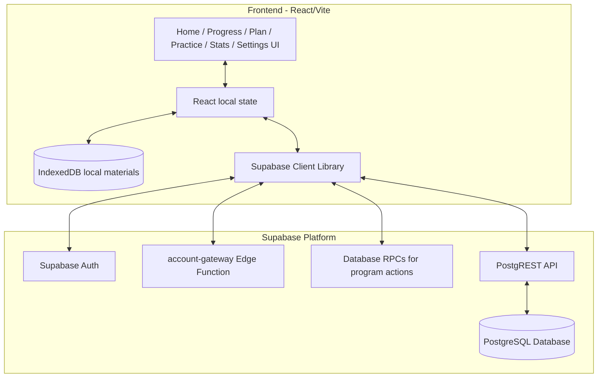

# System Architecture

This document describes the current high-level architecture of Guitar Practice Hub.

## High-Level Diagram

## System Components

### 1. Frontend
The application is a **single-page application (SPA)**.
- **View layer:** React components for Sessions, Plan, and Stats, combined through the shared app shell.
- **Navigation shell:** a floating menu provides Home, Progress, Plan, Practice, Stats, and Settings routes; child routes provide browser-history back navigation with a Home fallback.
- **Logic layer:** page-local state handles week/day navigation, timers, metronome controls, forms, and stats filters.
- **Data access layer:** `@supabase/supabase-js` communicates directly with Supabase.

### 2. Backend as a Service: Supabase
The project uses **Backend as a Service** instead of a custom Node.js or Python server:
- **Authentication:** manages user sessions and JWT tokens.
- **Database:** PostgreSQL with Row Level Security (RLS).
- **API layer:** PostgREST provides access to database tables.
- **Server-only account boundary:** `account-gateway` creates accounts and resets passwords using service-role access that never reaches the browser.
- **Language preference:** account creation accepts one of `en`, `ru`, `it`, or `fr`; the preference is persisted in `app_settings` and can later be changed from Settings.
- **Onboarding tour state:** `app_settings.onboarding_tour_pending` (boolean, default `false`) is set to `true` only by `account-gateway` at account creation. The app reads it once on first entry, clears it immediately, and runs the per-screen tour from in-memory state. Existing accounts keep `false`, so they never see the tour. The per-screen Help button replays one screen's tour and never touches this flag.
- **Program content language:** default programs store their creation language in `programs.language`. Continuation weeks use that stored value rather than the current interface preference.
- **Program lifecycle actions:** database RPCs manage default starts, custom starts, pause behaviors, and resume flows for programs.
- **Local materials:** IndexedDB stores uploaded learning files on the current device; files are not sent to Supabase.

## Security

Data security is enforced server-side through **Supabase Row Level Security (RLS)**:
1. The user authenticates through Supabase Auth.
2. The client sends requests with the user's JWT.
3. PostgreSQL evaluates each row policy, typically against `auth.uid()`.
4. Data is returned only when the policy permits access.

## Data Flow

### Saving a practice session
1. The user selects a week and day, completes blocks, and enters time or notes.
2. The frontend upserts the parent row with `supabase.from('sessions').upsert(...)`.
3. The frontend deletes only deselected session blocks.
4. The frontend upserts retained blocks into `session_blocks` using `(session_id, block_key)`.
5. Supabase validates the JWT and RLS policies for each request.
6. The frontend displays the save result and refreshes local state.

### Program timeline and week insertion

1. Progress loads scheduled weeks, program names, sessions, and visibility preferences.
2. Adjacent weeks with the same `program_id` form one contiguous program period; returning to a previous program creates a new period in the timeline.
3. Program periods collapse into timeline nodes, with the current period opened initially and every week remaining clickable to Plan.
4. Current and future weeks expose inline insertion forms backed by `insert_plan_week`, which shifts later scheduled weeks without pausing the active program.

### Continuing the Default program
1. Auth restoration triggers `ensureDefaultProgramContinuation()` from the auth gate.
2. The app loads the active default program, its stored content language, and its last scheduled week.
3. If the final week is in the past, it inserts the next logical week using the program's stored language.
4. The app keeps the continuation idempotent and avoids creating catch-up weeks for missed time.

### Language selection and content ownership
1. A new user selects a language only in Create account mode.
2. `account-gateway` validates the language, creates `app_settings`, and creates the first default program with the matching `programs.language` value.
3. A returning user signs in without changing the saved language.
4. Settings can update `app_settings.language` for interface behavior only.
5. Existing programs, weeks, sessions, songs, comments, and notes are never translated as a side effect of changing Settings.

### First-entry guided tour
1. `account-gateway` inserts `app_settings` with `onboarding_tour_pending = true` for a new account.
2. `Layout` (inside the router) reads the flag once; if `true`, it sets `onboarding_tour_pending = false` and keeps an in-memory onboarding state with a set of visited screens.
3. On each route, if onboarding is active and the screen is unvisited, that screen's steps run once; Skip ends onboarding for all screens.
4. The Help button in `Layout` replays the current screen's steps at any time without writing to Supabase.

## Current Limitations

- `session_blocks` uses unique `(session_id, block_key)` and the Sessions write path performs targeted delete plus upsert.
- Flexible Programs intentionally uses nullable week dates for unscheduled branch rows; all read paths must filter them before showing visible plan/calendar state.
- New scheduled weeks are program-owned and carry a required `program_sequence`; the unused `plan_weeks.phase` field is no longer part of the model.
- Enum-like fields such as `songs.status`, `sessions.source`, and `block_templates.key` are open `text` fields without database `CHECK` constraints. This is an explicit v1 trade-off; the application and seed data currently enforce the expected values by convention.
- Microphone pitch detection is deferred. The tuner reference-tone slice and the local learning-materials viewer are live.
- Mobile pinch zoom is intentionally disabled through the viewport configuration.
- The language preference and UI string catalog support English, Russian, Italian, and French. User-owned content remains in its stored language by design.
