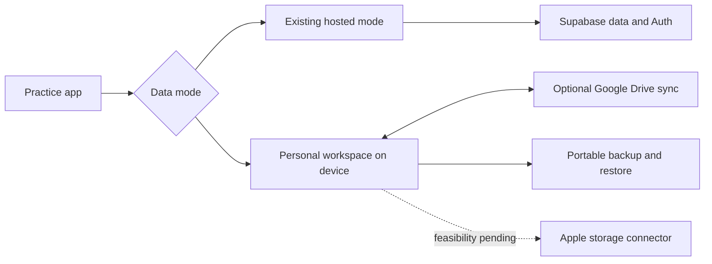

# Personal storage feasibility review

Date: 2026-11-10. Baseline: released 0.8.0, commit `7f91d4d`. Scope: research and product design for backlog item 76, not implementation or provider authorization. Calendar reminders are separately recorded as item 75.

## Owner requirement

Users may choose personal storage for their practice data and learning/reference materials. In this mode the app must avoid **all Supabase use**, including login/Auth, profiles and background calls. Google Drive, Apple iCloud and local-device storage are requested destinations. Existing hosted mode can remain available separately.

The goal is a portable personal workspace: a user should be able to open the same cloud workspace on another supported device and recover their plans, songs, history, preferences and materials. Merely exporting a file or uploading PDFs does not provide that behavior.

## Current implementation

Structured data lives in Supabase: programs, weeks, block composition/catalog overrides, songs, daily song choices, sessions, notes and preferences. Pages and helpers call PostgREST/RPCs directly. Authentication, startup initialization and material ownership also rely on the Supabase user identity.

Material bytes already live on the device in IndexedDB/CacheStorage. Their owner UID/auth epoch and song/block references are checked before list, playback, rename and deletion. Moving those files to Drive would not relocate the structured database or remove the login dependency. Conversely, copying the database would not upload files stored only on a particular phone.

Relevant boundaries include `src/main.tsx`, `src/components/AuthGate.tsx`, `src/lib/supabase.ts`, `src/lib/i18n.tsx`, `src/lib/localMaterialAccess.ts`, `src/lib/localMaterials.ts`, `src/lib/catalogApi.ts`, `src/lib/songPracticeApi.ts` and the page-level queries. Personal mode must be selected before hosted-client initialization; hiding the login screen alone is insufficient.

## Provider comparison

| Destination | Plausible first capability | Important constraint |
| --- | --- | --- |
| Google Drive | A user-owned app workspace with structured files and material files; a second device authorizes the same Google account and opens that workspace. | Requires Google authorization, a registered app, careful file permissions, reconnection and a real synchronization design. |
| Apple iCloud | Investigate a CloudKit private app database or a native integration for iCloud Drive documents. | CloudKit app containers are different from general access to an arbitrary iCloud Drive folder. Do not promise a drop-in Drive-equivalent web connector. |
| Local device | Browser-local workspace plus explicit portable export/import; user-selected folders where browser support permits. | Local storage alone does not synchronize other devices. Browser storage and an ordinary user-visible folder are different storage mechanisms. |

Google's Drive API supports app-created/user-authorized files through the narrow `drive.file` scope. A visible app-created folder is a candidate when user access and portability matter. The hidden `appDataFolder` is another option for internal data, but users cannot browse its files in Drive, and sharing/moving/trashing are restricted. These are product choices, not interchangeable implementations. Sources: [Drive scopes](https://developers.google.com/workspace/drive/api/guides/api-specific-auth), [application data folders](https://developers.google.com/workspace/drive/api/guides/appdata).

Google's browser token model can call Drive without storing per-user refresh tokens on an app backend. Its access tokens expire and renewal is user-driven, so an entirely browser-based app needs a clear reconnect path. This does not promise unattended synchronization while the app is closed. Large files should use resumable transfers. Sources: [browser token model](https://developers.google.com/identity/oauth2/web/guides/use-token-model), [resumable uploads](https://developers.google.com/workspace/drive/api/guides/manage-uploads).

Apple documents CloudKit JS as web access to an app's CloudKit containers/private databases, with CloudKit app setup and web-service configuration. This establishes a possible app-data direction, not generic iCloud Drive folder access or an already proven PWA-only solution. A separate spike must establish provisioning, sign-in, browser/device coverage, media handling and whether a native companion is needed. Source: [CloudKit JS](https://developer.apple.com/documentation/CloudKitJS?changes=latest_major).

Browser folder access is not uniformly available. Origin-private storage is broadly available but belongs to the site's browser storage, is subject to quotas and can be deleted with site data. It is not a user-visible synced folder. Source: [directory picker](https://developer.mozilla.org/en-US/docs/Web/API/Window/showDirectoryPicker), [origin-private storage](https://developer.mozilla.org/en-US/docs/Web/API/File_System_API/Origin_private_file_system).

## Recommended direction

Retain hosted mode and introduce a separate local-first personal workspace. The UI reads and writes through a data-access boundary rather than issuing Supabase calls directly. Personal mode uses a local working copy and an optional provider synchronizer; hosted mode uses the existing backend. Workspace identity must be independent of Supabase Auth and must not be inferred from an email address.

The personal workspace contains preferences, custom blocks, program/week configuration, songs and daily choices, sessions/notes and stable material/bookmark references. Portable export must also retain archived records such as legacy ToDos even though their UI is retired. Built-in catalog definitions and reference PDFs can be distributed with the app; they must not require a logged-in catalog RPC. Shared data-access operations need a local implementation, including initialization and multi-record changes that current RPCs perform atomically. Hosted passwords and recovery credentials are not copied into the workspace; personal mode uses its own provider/local access model.

Keep structured data separate from large media bytes. Use stable IDs, a versioned manifest, revisions and recoverable transfer checkpoints. A single whole-workspace file repeatedly overwritten from two devices is not a safe multi-device design. Offline edits need a queue and conflict handling; record deletion needs a retained deletion marker so an old offline device does not recreate removed content. Simultaneous timers must not silently double-count a session.

Authorization to Google Drive is not the same thing as an application account. In Drive mode the provider grants access to the chosen workspace; local-only mode can use a local workspace without online login. Revoked permissions, a changed Google account, lost connectivity and a different workspace must produce distinct recoverable states. Do not silently fall back to Supabase when personal storage fails.

## Migration and recovery

1. Explicitly export the user's existing hosted records and inventory materials on the current device. Accessing the old account during this copy step is separate from the final personal-mode behavior.
2. Copy into a new workspace, preserving IDs and song/block/bookmark relationships. Files that exist only on another device cannot be invented; identify missing bytes and allow those devices to contribute them later.
3. Verify entity counts, relationships and material hashes before switching. Keep the original database and local files intact; do not implement an automatic delete-from-Supabase step.
4. Reopen the workspace on a second supported device and verify history, selected-day songs, a PDF and a reference link. Test offline edits, concurrent edits, deletions, interrupted uploads, revoked access and restore from backup.
5. Provide export/restore independent of a single storage provider. Provider synchronization is not itself a backup against accidental or synchronized deletion.

Personal mode's acceptance test must block Supabase network access entirely and still cover startup, preferences, catalog/default program creation, day selection, saving history, stats and materials. This catches otherwise hidden session refresh, account initialization or settings requests.

## Proposed sequence and decisions

1. Define a portable workspace format and prove a small Supabase-free local workspace, including recovery/export. Keep this first slice narrow and explicit about incomplete screens.
2. Prove Google Drive authorization and a complete two-device round trip for a small plan, song, practice record and PDF/reference. This is a synchronization proof, not merely a backup upload.
3. Extend offline conflict handling, media transfers, switching and migration, then cover the remaining app data and pages. Do not label the entire mode Supabase-independent until every path passes the network-denial checks.
4. Investigate Apple integration separately; keep local export/import as a practical fallback without calling it automatic iCloud sync.

Open decisions: visible Drive folder versus hidden internal data; client-only reconnect behavior versus a separate authorization helper; encryption and cross-device key recovery; optional versus required media upload; conflict presentation; media caching policy; and the first supported browser/device matrix. User ownership does not by itself mean end-to-end encryption or that Google/Apple cannot access data. No operating-cost or background-sync guarantee is established by this review.

No application code, schema, dependencies, provider settings or live data were changed for this review.
